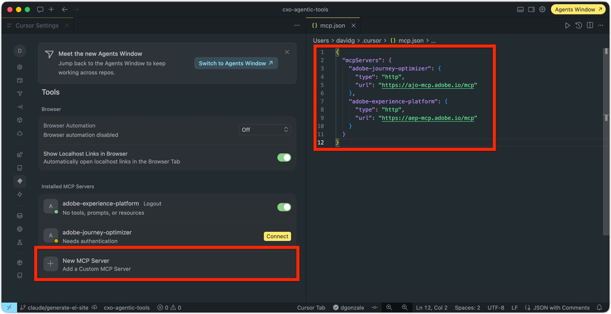
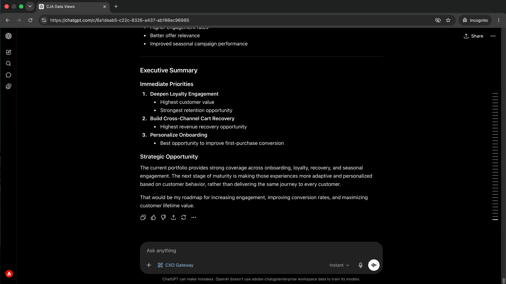
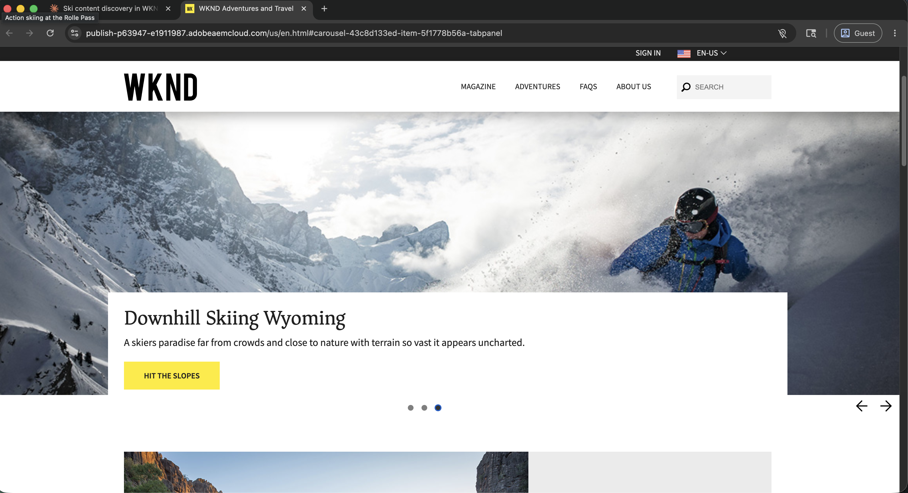
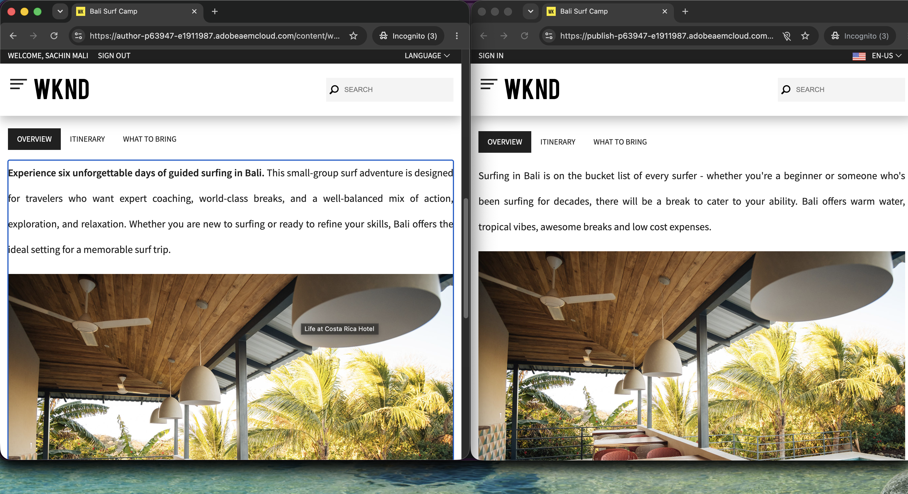

# Servidores MCP

<!-- last-modified: 2026-09-16 -->

Os servidores MCP da Adobe fornecem acesso direto e controlado a dados e workflows do Adobe a qualquer plataforma de IA compatível. Conecte-se uma vez e poderá consultar o desempenho da campanha, ativar públicos, revisar jornadas, gerenciar conteúdo e muito mais, tudo em linguagem simples, sem sair do ambiente de IA. Como os servidores MCP ficam entre sua plataforma de IA e os sistemas subjacentes da Adobe, você obtém flexibilidade de linguagem natural enquanto os controles de acesso e a governança de dados de sua organização permanecem em vigor.

Os servidores MCP do Adobe seguem o padrão [Model Context Protocol](https://modelcontextprotocol.io/docs/getting-started/intro) aberto. Qualquer plataforma de IA compatível com MCP se conecta a qualquer servidor MCP do Adobe.

>[!TIP]
>
>**Comece com o Adobe CX Enterprise Coworker para Plataformas de IA.** É a melhor maneira de usar o Adobe MCP com sua plataforma de IA. Adicione um servidor MCP ao Claude, ChatGPT, Microsoft 365 Copilot, Gemini Enterprise e muito mais, e trabalhe com o Adobe CX Enterprise Coworker a partir daí.
>
>* **Uma conexão, não muitas.** Você configura um servidor MCP em vez de conectar cada aplicativo do Adobe separadamente.
>* **Seu acesso, postergado.** Você faz logon com as credenciais da Adobe e o Co-worker usa o acesso que você já tem. Não há configuração de permissões separadas.
>* **Seguro e controlado por design.** O colega de trabalho dá a cada usuário acesso controlado aos aplicativos da CX Enterprise por trás dele. Alguns usuários podem ter acesso somente leitura a determinado conteúdo ou dados, e outros, acesso de leitura e gravação, dependendo de como seu usuário está configurado e qual acesso foi concedido a eles. [Saiba mais sobre o controle de acesso no Colaborador](https://experienceleague.adobe.com/en/docs/coworker/content/administration/access-control).
>
>Já está trabalhando em outras plataformas de IA e criou fluxos de trabalho em torno delas? Você também pode acessar os recursos do Coworker nessas plataformas, sem alterar a forma como você trabalha. [Configurar o Colaborador para plataformas de IA](#connect-to-your-ai-platform)
>
>Se isso não for uma opção para você, você também pode [conectar sua plataforma de IA diretamente aos servidores MCP do produto](#connect-to-your-ai-platform).

## Servidores MCP do CX Enterprise {#cx-enterprise-mcp-servers}

>[!CONTEXTUALHELP]
>id="cx-enterprise-agentic-tools_mcp_servers_cx-enterprise"
>title="Coworker"
>abstract="Pergunte, analise e execute ações nos aplicativos CX Enterprise em linguagem simples, sem precisar configurar o servidor. Nos aplicativos individuais com seu próprio servidor MCP, em vez disso, conecte-se diretamente."
>additional-url="https://experienceleague.adobe.com/pt-br/docs/cx-enterprise-coworker/content/home" text="Documentação do colega"


Há três maneiras de trabalhar com seus aplicativos da CX Enterprise por meio da IA. Explore-os nesta ordem:

1. **Colaborador.** A maneira mais rápida de trabalhar com seus aplicativos CX Enterprise. É compatível com eles, sem configuração de servidor, sem endpoint para registrar e sem configuração de plataforma de IA. [Experimente o Colaborador](https://experienceleague.adobe.com/pt-br/docs/cx-enterprise-coworker/content/home)
2. **Colaborador para plataformas de IA.** Se você não pode ou não quer usar o Coworker diretamente, use-o a partir de sua própria plataforma de IA, como o Microsoft 365 Copilot, ChatGPT ou Claude. [Configurar o Colaborador para plataformas de IA](#connect-to-your-ai-platform)
3. **Servidores MCP de produtos.** Se nenhuma das opções funcionar para você, conecte sua plataforma de IA diretamente ao servidor MCP para um aplicativo específico do Adobe. [Conectar a um servidor MCP de produto](#connect-to-your-ai-platform)

Vários aplicativos têm seu próprio servidor MCP.

| Servidor MCP | Endpoint | O que você pode fazer | Também via Colaborador |
| --- | --- | --- | --- |
| [Adobe Journey Optimizer](https://experienceleague.adobe.com/en/docs/experience-cloud-ai/experience-cloud-ai/mcp/mcp-product-tools/ajo-mcp) | `https://ajo-mcp.adobe.io/mcp` | Revisar jornadas, campanhas e configurações de canal | Sim |
| [Customer Journey Analytics](https://experienceleague.adobe.com/en/docs/experience-cloud-ai/experience-cloud-ai/mcp/mcp-product-tools/cja-mcp) | `https://cja-mcp.adobe.io/mcp` | Relatórios de query, visualizações de dados de descoberta e espaços de trabalho do autor | Sim |
| [Adobe Analytics](https://experienceleague.adobe.com/en/docs/experience-cloud-ai/experience-cloud-ai/mcp/mcp-product-tools/analytics-mcp) | `https://aa-mcp.adobe.io/mcp` | Descoberta do conjunto de relatórios, criação de segmentos e criação de espaços de trabalho | Sim |
| [Adobe Target](https://experienceleague.adobe.com/en/docs/target/using/mcp/target-mcp) | `https://targetmcp.adobe.io/mcp` | Atividades de revisão, ofertas, públicos, mboxes, relatórios de desempenho e URLs de visualização (beta público: as ferramentas são somente leitura e as ferramentas de gravação estão planejadas para disponibilidade geral) | Sim |
| [Real-Time CDP](https://experienceleague.adobe.com/en/docs/experience-platform/rtcdp/intro/rtcdp-mcp) | `https://rtcdp-mcp.adobe.io/mcp` | Pesquisar públicos, destinos, fontes e execuções de fluxo; inspecionar namespaces de identidade e políticas de mesclagem (beta público: incluo na lista de permissões necessário, todas as ferramentas são somente leitura) | Sim |
| [AEM MCP Server](https://experienceleague.adobe.com/pt-br/docs/experience-manager-learn/cloud-service/ai/mcp-servers/overview) | `https://mcp.adobeaemcloud.com/adobe/mcp/aem` | Gerenciar páginas, fragmentos de conteúdo, ativos e lançamentos; avaliar conteúdo e imagens em relação às diretrizes da marca e regras de conformidade | Sim |
| [AEM Cloud Manager](https://experienceleague.adobe.com/pt-br/docs/experience-manager-learn/cloud-service/ai/mcp-servers/cloud-manager) | `https://mcp.adobeaemcloud.com/adobe/mcp/cloudmanager` | Gerenciar programas, ambientes, pipelines e repositórios | Não |
| Adobe Marketing Agent | `https://aep-ai-ama.adobe.io/mcp` | Orquestrar a análise de público-alvo, o diagnóstico AEP e a criação de jornada B2B do AJO em aplicativos da AEP | Não |
| [Adobe Workfront](https://experienceleague.adobe.com/en/docs/workfront/using/basics/workfront-mcp-server/workfront-mcp-server-overview) | `https://mcp.prod.us-west-2.aws.wfk8s.com/mcp/v1/workfront` | Gerenciar trabalhos, projetos, registros de planejamento, insights e aprovações de conteúdo | Não |
| [Marketo Engage](https://experienceleague.adobe.com/en/docs/marketo-developer/marketo/mcp-server) | `https://marketo-mcp.adobe.io/mcp` | Gerenciar formulários, campanhas inteligentes, clientes potenciais, listas, programas, emails e operações em massa | Sim |
| Adobe Experience Platform | Via [Colaborador](https://experienceleague.adobe.com/pt-br/docs/cx-enterprise-coworker/content/home) | Detecção de conjuntos de dados, navegação por esquemas e gerenciamento de sandbox | N/A |
| Campaign Classic | Via [Colaborador](https://experienceleague.adobe.com/pt-br/docs/cx-enterprise-coworker/content/home) | Descoberta de instância de campanha, navegação de esquema, execução de consulta, controle de fluxo de trabalho e execução de SOAP/JS | N/A |
| Experimentação | Via [Colaborador](https://experienceleague.adobe.com/pt-br/docs/cx-enterprise-coworker/content/home) | Relatórios de experimento A/B, MVT e MAB, métricas, insights, oportunidades e planejamento de tamanho de amostra | N/A |
| GenStudio para marketing de desempenho | Via [Colaborador](https://experienceleague.adobe.com/pt-br/docs/cx-enterprise-coworker/content/home) | Acessar dados de desempenho do anúncio e insights criativos | N/A |
| Adobe Journey Optimizer B2B Edition | Via [Colaborador](https://experienceleague.adobe.com/pt-br/docs/cx-enterprise-coworker/content/home) | Gerenciar jornadas B2B, programas de conta, grupos de compra e personalização | N/A |

>[!NOTE]
>
>O acesso a cada servidor MCP depende dos direitos da organização para esse aplicativo e das permissões do usuário nele. As últimas cinco linhas ainda não têm seu próprio servidor MCP disponível para conexão direta. Use o Colaborador para contatá-los hoje.

## Conectar-se à plataforma de IA {#connect-to-your-ai-platform}

A maioria dos servidores MCP do Adobe usa o OAuth com o Adobe Identity Management Service (IMS). Selecione a organização IMS correta quando solicitado. Escolher o errado é a fonte mais comum de erros de autenticação.


Se você usar o Coworker diretamente, nada abaixo se aplica a você. Para usar o Coworker a partir de sua própria plataforma de AI, comece com a guia **Coworker para plataformas de AI**. As guias restantes são para conectar sua própria plataforma de IA diretamente a um servidor MCP do Adobe e usar o endpoint do servidor MCP do AEM como exemplo. O mesmo processo se aplica a qualquer servidor MCP do Adobe: troque o URL do ponto de extremidade pelo servidor que você deseja conectar.

>[!BEGINTABS]

>[!TAB Coworker]

O colega de trabalho já inclui muitos desses recursos de MCP. Não há um servidor para adicionar, nenhum terminal para registrar e nenhuma plataforma de IA para configurar. Entre no Co-worker e ele está pronto para uso.

Documentação completa: [Documentação do colega](https://experienceleague.adobe.com/pt-br/docs/cx-enterprise-coworker/content/home)

>[!TAB Colaborador para plataformas de IA]

O Co-worker para plataformas de IA é um servidor MCP que conecta sua plataforma de IA ao Co-worker. Tudo o que está disponível no Co-worker está disponível por meio dele. Você usa sua plataforma de IA, como Claude, ChatGPT, Microsoft 365 Copilot ou Gemini Enterprise, como a interface de bate-papo, e o Coworker faz o trabalho em segundo plano, da mesma forma que usa o Coworker diretamente.

Você faz logon com suas credenciais da Adobe e o Co-worker usa o acesso vinculado à sua identidade da Adobe. O colega de trabalho está seguro e é regido pelo design. O que você pode ler ou alterar depende de como seu usuário está configurado, do acesso concedido a você no Coworker e do acesso concedido nos aplicativos que o Coworker usa em seu nome. Consulte [Controle de acesso para Colaborador](https://experienceleague.adobe.com/en/docs/coworker/content/administration/access-control).

Antes de começar, verifique se:

* O colaborador é provisionado para sua organização e você tem acesso a ele no Adobe.
* Sua organização tem a Adobe Experience Platform e pelo menos um dos produtos Adobe Real-Time CDP, Adobe Journey Optimizer ou Adobe Customer Journey Analytics.
* Ter acesso a uma plataforma de IA compatível.

O ponto de extremidade do servidor é `https://mcp.coworker.experience.adobe.io`. A configuração difere de acordo com a plataforma de IA e geralmente começa com um administrador aprovando o Adobe CX Enterprise Coworker para sua organização. [Configurar o Colaborador para plataformas de IA](https://experienceleague.adobe.com/en/docs/coworker/content/ai-platforms#set-up-coworker)

>[!TAB Claude.ai]

###  Usar um conector gerenciado

Vá para o [Registro do Adobe AI](https://developer.adobe.com/ai-registry/?type=connector) e pesquise seu aplicativo do Adobe. Se um conector Claude estiver listado (por exemplo, o [conector Adobe Experience Manager](https://developer.adobe.com/ai-registry/#/connectors/adobe-experience-manager-connector)), siga as instruções de configuração em vez das etapas abaixo.

### Conectar usando um conector personalizado

O Claude.ai oferece suporte a servidores MCP remotos por meio dos Conectores personalizados nas configurações da conta.

1. Vá para **Configurações > Integrações**.
2. Clique em **Adicionar conector personalizado**.
3. Insira o ponto de extremidade do servidor como a URL (por exemplo, `https://mcp.adobeaemcloud.com/adobe/mcp/aem` para o servidor MCP do AEM) e um nome para exibição de sua escolha.
4. Clique em **Conectar** e entre com sua Adobe ID. Selecione a organização IMS correta.

Configuração completa: [documentação dos Conectores personalizados do Claude.ai](https://support.claude.com/en/articles/11175166-get-started-with-custom-connectors-using-remote-mcp)

>[!TAB Código Claude]

### Uso da CLI

Execute `claude mcp add` para registrar um servidor MCP do Adobe. Substitua o nome do servidor e o URL pelos valores do servidor que você deseja conectar. Este exemplo usa o AEM MCP Server:

```bash
claude mcp add --transport http adobe-aem https://mcp.adobeaemcloud.com/adobe/mcp/aem
```

### Editar seu arquivo de configurações

Adicione o servidor a `~/.claude.json` (global) ou `.mcp.json` na raiz do projeto (nível de projeto). Substitua a chave e o URL pelos valores do servidor que você deseja conectar:

```json
{
  "mcpServers": {
    "adobe-aem": {
      "type": "http",
      "url": "https://mcp.adobeaemcloud.com/adobe/mcp/aem"
    }
  }
}
```

Os servidores MCP do Adobe usam OAuth. O Claude Code solicita a autenticação com o Adobe ID na primeira vez que você chama uma ferramenta. Selecione a organização IMS correta quando solicitado.

Configuração completa: [documentação MCP do Claude Code](https://docs.anthropic.com/en/docs/claude-code/mcp)

>[!TAB Cursor]

Adicione um servidor Adobe MCP ao arquivo de configuração Cursor `mcp.json` e conecte-se por meio de **Configurações > MCP**. Substitua a chave e o URL pelos valores do servidor que você deseja conectar. Este exemplo usa o AEM MCP Server:

- **Global (todos os projetos):** `~/.cursor/mcp.json`
- **Nível do projeto:** `.cursor/mcp.json` na raiz do projeto

```json
{
  "mcpServers": {
    "adobe-aem": {
      "type": "http",
      "url": "https://mcp.adobeaemcloud.com/adobe/mcp/aem"
    }
  }
}
```

Depois de adicionados, os servidores MCP aparecem em **Servidores MCP instalados** nas Configurações do Cursor. Selecione **Conectar** ao lado de qualquer servidor que mostre que **Precisa de autenticação** e entre com sua Adobe ID. Selecione a organização IMS que tem acesso ao aplicativo.



Configuração completa: [Documentação de MCP do cursor](https://cursor.com/docs/mcp)

>[!TAB GPTchat]

###  Usar um conector gerenciado

Vá para o [Registro do Adobe AI](https://developer.adobe.com/ai-registry/?type=connector) e pesquise seu aplicativo do Adobe. Se um conector de ChatGPT estiver listado, siga as instruções de configuração em vez das etapas abaixo.

### Conectar usando um servidor MCP remoto

Peça ao administrador do ChatGPT para adicionar o servidor MCP à sua organização. Isso permite que todos os usuários se conectem sem a configuração abaixo.

Se um administrador não puder adicioná-la ou se você quiser a conexão somente para sua conta, siga estas etapas.

**Configuração única:** ative o Modo de desenvolvedor antes de registrar uma URL MCP personalizada.

1. Vá para **Configurações > Segurança e faça logon**.
2. Ative o **Modo de desenvolvedor**.

**Adicionar um servidor:**

1. Vá para **Configurações > Plug-ins > Procurar Plug-ins**.
2. Selecione **+** para adicionar um novo plug-in.
3. Digite um nome, por exemplo `AEM MCP Server` ou `Adobe Journey Optimizer`.
4. Insira uma descrição.
5. Selecione a **URL do Servidor**.
6. Em **Connection**, insira a URL completa do MCP do Adobe. Por exemplo, `https://mcp.adobeaemcloud.com/adobe/mcp/aem` para AEM ou `https://ajo-mcp.adobe.io/mcp` para Adobe Journey Optimizer.
7. Definir **Autenticação** para **OAuth**.
8. Leia e aceite os termos de serviço.
9. Selecione **Criar**.
10. Faça logon com a conta do Adobe que tem acesso ao aplicativo do CX Enterprise ao qual o servidor MCP se conecta.

Configuração completa: [Documentação de MCP ChatGPT](https://developers.openai.com/api/docs/guides/tools-connectors-mcp)

>[!TAB CLI do OpenAI Codex]

A CLI do OpenAI Codex oferece suporte a servidores MCP remotos por meio da configuração TOML.

**Locais do arquivo de configuração:**

- **Nível de usuário (todos os projetos):** `~/.codex/config.toml`
- **Com escopo de projeto:** `.codex/config.toml` na raiz do projeto

Substitua o nome da seção e o URL pelos valores do servidor que você deseja conectar. Este exemplo usa o AEM MCP Server:

```toml
[mcp_servers.adobe-aem]
url = "https://mcp.adobeaemcloud.com/adobe/mcp/aem"
enabled = true
```

Os servidores MCP do Adobe usam OAuth. O Codex CLI lida com o fluxo do OAuth automaticamente no primeiro uso. Selecione a organização IMS correta quando solicitado.

Configuração completa: [Documentação de MCP do OpenAI Codex CLI](https://developers.openai.com/codex/mcp)

>[!TAB Copilot Studio]

O Microsoft Copilot Studio se conecta a servidores MCP remotos usando o Assistente de integração de MCP, que cria automaticamente um conector personalizado da Plataforma de energia.

1. Abra o agente no Copilot Studio.
2. Vá para a página **Ferramentas**.
3. Selecione **Adicionar uma ferramenta > Nova ferramenta > Protocolo de Contexto de Modelo**.
4. No Assistente de integração do MCP, insira os detalhes do servidor. Por exemplo, para o Servidor MCP AEM:
   - **Nome do servidor:** `AEM`
   - **URL do Servidor:** `https://mcp.adobeaemcloud.com/adobe/mcp/aem`
5. Defina a autenticação como **OAuth 2.0** e configure com sua autorização do Adobe IMS e URLs de token.
6. Selecione **Criar** e **Adicionar ao agente**.

>[!NOTE]
>
>As conexões de servidor MCP no Copilot Studio passam pela Power Platform. As políticas de prevenção de perda de dados (DLP) de sua organização se aplicam.

Configuração completa: [Documentação do Copilot Studio MCP](https://learn.microsoft.com/microsoft-copilot-studio/mcp-add-existing-server-to-agent)

>[!ENDTABS]

## Servidores MCP em ação

Consulte os servidores MCP da Adobe que são colocados para trabalhar em problemas reais de negócios. Cada passo a passo começa com um desafio operacional genuíno e mostra como uma plataforma de IA o resolve em linguagem simples, sem alternar ferramentas ou escrever código.

<!--
CARDS

* ../use-cases/analyze-campaign-performance.md
  {title = Campaign insights without reports}
  {description = Ask performance questions in plain language and get answers from Customer Journey Analytics, without building a single report.}
  {cta = Surface campaign insights}

* ../use-cases/query-audiences.md
  {title = Audience activation at a glance}
  {description = See which audiences are live, where they are flowing, and whether destinations are healthy, without navigating Real-Time CDP.}
  {cta = Check audience activation}

* ../use-cases/manage-ajo-journeys.md
  {title = Catch journey issues early}
  {description = Monitor active journeys and surface operational issues before they reach your audience.}
  {cta = Monitor your journeys}

* ../use-cases/manage-aem-content.md
  {title = Ship content updates faster}
  {description = Find, update, and publish AEM pages and content fragments faster, without switching to the AEM interface.}
  {cta = Ship content faster}

* ../use-cases/optimize-content-with-performance-data.md
  {title = Close content performance gaps}
  {description = Surface conversion gaps in CJA, trace them to underperforming content in AEM, and apply the fix in a single AI session.}
  {cta = Close performance gaps}
-->

<!-- START CARDS HTML - DO NOT MODIFY BY HAND -->
<div class="columns">
    <div class="column is-half-tablet is-half-desktop is-one-third-widescreen" aria-label="Campaign insights without reports">
        <div class="card" style="height: 100%; display: flex; flex-direction: column; height: 100%;">
            <div class="card-image">
                <figure class="image x-is-16by9">
                    <a href="../use-cases/analyze-campaign-performance.md" title="Insights do Campaign sem relatórios">
                        
                    </a>
                </figure>
            </div>
            <div class="card-content is-padded-small" style="display: flex; flex-direction: column; flex-grow: 1; justify-content: space-between;">
                <div class="top-card-content">
                    <p class="headline is-size-6 has-text-weight-bold">
                        <a href="../use-cases/analyze-campaign-performance.md" title="Insights do Campaign sem relatórios">Insights da campanha sem relatórios</a>
                    </p>
                    <p class="is-size-6">Faça perguntas de desempenho em linguagem simples e obtenha respostas do Customer Journey Analytics, sem criar um único relatório.</p>
                </div>
                <a href="../use-cases/analyze-campaign-performance.md" class="spectrum-Button spectrum-Button--outline spectrum-Button--primary spectrum-Button--sizeM" style="align-self: flex-start; margin-top: 1rem;">
                    <span class="spectrum-Button-label has-no-wrap has-text-weight-bold">Insights de campanha de superfície</span>
                </a>
            </div>
        </div>
    </div>
    <div class="column is-half-tablet is-half-desktop is-one-third-widescreen" aria-label="Audience activation at a glance">
        <div class="card" style="height: 100%; display: flex; flex-direction: column; height: 100%;">
            <div class="card-image">
                <figure class="image x-is-16by9">
                    <a href="../use-cases/query-audiences.md" title="Principais características da ativação de público-alvo">
                        
                    </a>
                </figure>
            </div>
            <div class="card-content is-padded-small" style="display: flex; flex-direction: column; flex-grow: 1; justify-content: space-between;">
                <div class="top-card-content">
                    <p class="headline is-size-6 has-text-weight-bold">
                        <a href="../use-cases/query-audiences.md" title="Principais características da ativação de público-alvo">Principais características da ativação de público-alvo</a>
                    </p>
                    <p class="is-size-6">Veja quais públicos-alvo estão ativos, onde estão fluindo e se os destinos estão íntegros, sem navegar no Real-Time CDP.</p>
                </div>
                <a href="../use-cases/query-audiences.md" class="spectrum-Button spectrum-Button--outline spectrum-Button--primary spectrum-Button--sizeM" style="align-self: flex-start; margin-top: 1rem;">
                    <span class="spectrum-Button-label has-no-wrap has-text-weight-bold">Verificar ativação de público-alvo</span>
                </a>
            </div>
        </div>
    </div>
    <div class="column is-half-tablet is-half-desktop is-one-third-widescreen" aria-label="Catch journey issues early">
        <div class="card" style="height: 100%; display: flex; flex-direction: column; height: 100%;">
            <div class="card-image">
                <figure class="image x-is-16by9">
                    <a href="../use-cases/manage-ajo-journeys.md" title="Problemas de jornada de capturas antecipadas">
                        
                    </a>
                </figure>
            </div>
            <div class="card-content is-padded-small" style="display: flex; flex-direction: column; flex-grow: 1; justify-content: space-between;">
                <div class="top-card-content">
                    <p class="headline is-size-6 has-text-weight-bold">
                        <a href="../use-cases/manage-ajo-journeys.md" title="Problemas de jornada de capturas antecipadas">Detectar problemas de jornada antecipadamente</a>
                    </p>
                    <p class="is-size-6">Monitore jornadas ativas e detecte problemas operacionais antes que eles atinjam seu público-alvo.</p>
                </div>
                <a href="../use-cases/manage-ajo-journeys.md" class="spectrum-Button spectrum-Button--outline spectrum-Button--primary spectrum-Button--sizeM" style="align-self: flex-start; margin-top: 1rem;">
                    <span class="spectrum-Button-label has-no-wrap has-text-weight-bold">Monitorar suas jornadas</span>
                </a>
            </div>
        </div>
    </div>
    <div class="column is-half-tablet is-half-desktop is-one-third-widescreen" aria-label="Ship content updates faster">
        <div class="card" style="height: 100%; display: flex; flex-direction: column; height: 100%;">
            <div class="card-image">
                <figure class="image x-is-16by9">
                    <a href="../use-cases/manage-aem-content.md" title="Enviar atualizações de conteúdo mais rapidamente">
                        
                    </a>
                </figure>
            </div>
            <div class="card-content is-padded-small" style="display: flex; flex-direction: column; flex-grow: 1; justify-content: space-between;">
                <div class="top-card-content">
                    <p class="headline is-size-6 has-text-weight-bold">
                        <a href="../use-cases/manage-aem-content.md" title="Enviar atualizações de conteúdo mais rapidamente">Enviar atualizações de conteúdo mais rapidamente</a>
                    </p>
                    <p class="is-size-6">Encontre, atualize e publique páginas e fragmentos de conteúdo do AEM com mais rapidez, sem alternar para a interface do AEM.</p>
                </div>
                <a href="../use-cases/manage-aem-content.md" class="spectrum-Button spectrum-Button--outline spectrum-Button--primary spectrum-Button--sizeM" style="align-self: flex-start; margin-top: 1rem;">
                    <span class="spectrum-Button-label has-no-wrap has-text-weight-bold">Enviar conteúdo mais rápido</span>
                </a>
            </div>
        </div>
    </div>
    <div class="column is-half-tablet is-half-desktop is-one-third-widescreen" aria-label="Close content performance gaps">
        <div class="card" style="height: 100%; display: flex; flex-direction: column; height: 100%;">
            <div class="card-image">
                <figure class="image x-is-16by9">
                    <a href="../use-cases/optimize-content-with-performance-data.md" title="Fechar as lacunas de desempenho do conteúdo">
                        
                    </a>
                </figure>
            </div>
            <div class="card-content is-padded-small" style="display: flex; flex-direction: column; flex-grow: 1; justify-content: space-between;">
                <div class="top-card-content">
                    <p class="headline is-size-6 has-text-weight-bold">
                        <a href="../use-cases/optimize-content-with-performance-data.md" title="Fechar as lacunas de desempenho do conteúdo">Fechar lacunas de desempenho de conteúdo</a>
                    </p>
                    <p class="is-size-6">Superar falhas de conversão no CJA, rastreá-las até o conteúdo com baixo desempenho no AEM e aplicar a correção em uma única sessão de IA.</p>
                </div>
                <a href="../use-cases/optimize-content-with-performance-data.md" class="spectrum-Button spectrum-Button--outline spectrum-Button--primary spectrum-Button--sizeM" style="align-self: flex-start; margin-top: 1rem;">
                    <span class="spectrum-Button-label has-no-wrap has-text-weight-bold">Fechar lacunas de desempenho</span>
                </a>
            </div>
        </div>
    </div>
</div>
<!-- END CARDS HTML - DO NOT MODIFY BY HAND -->

## Precisa de mais ajuda?

As conexões do MCP envolvem autenticação, seleção de organização e permissões no nível do aplicativo. Se algo não estiver funcionando como o esperado, essas etapas abordam as causas mais comuns.

+++Alternar organizações da Adobe

Se o usuário do Adobe pertencer a várias organizações IMS e você estiver vendo ferramentas ou dados para a organização errada, desconecte o servidor MCP, saia da sessão do Adobe no navegador e reconecte. Você será solicitado a escolher uma organização durante o logon.

Um servidor MCP do Adobe só pode ser autenticado em uma organização IMS por vez, mesmo se a conta de usuário tiver acesso a mais de uma.

+++

+++Especificação de uma sandbox, conjunto de relatórios, ambiente ou outro recurso de sessão

Alguns servidores MCP do Adobe exigem que você especifique um recurso antes que eles possam retornar resultados. Dependendo do aplicativo, pode ser uma sandbox, um programa, um ambiente, um conjunto de relatórios ou uma visualização de dados.

Se não tiver certeza de quais recursos você tem acesso, pergunte à plataforma de IA. Por exemplo: &quot;Listar as sandboxes disponíveis&quot; ou &quot;A quais conjuntos de relatórios tenho acesso?&quot; Os servidores MCP da Adobe geralmente podem retornar uma lista completa de recursos disponíveis para o usuário.

Depois que um recurso de sessão é definido, você pode alterná-lo a qualquer momento informando à plataforma de IA qual usar.

+++

+++Erros de permissões e acesso

As plataformas de IA agem em nome da sua conta de usuário do Adobe usando OAuth. As mesmas permissões e controles de acesso que se aplicam quando você faz logon em um aplicativo do Adobe se aplicam quando você usa um servidor MCP.

Se uma ação falhar ou não retornar resultados, verifique se o usuário tem as permissões necessárias no Adobe Admin Console e no aplicativo relevante do CX Enterprise. Entre em contato com o administrador do sistema da Adobe se precisar ajustar o acesso.

+++

+++Reautenticação após uma sessão perdida

Os servidores MCP do Adobe usam o OAuth para autenticar sua conta de usuário do Adobe. Se o estado de autenticação for perdido, nenhuma outra chamada de ferramenta será bem-sucedida até que você faça a autenticação novamente.

Para autenticar novamente: abra a configuração do servidor MCP da plataforma AI, selecione a entrada do servidor MCP do Adobe e reconecte. Você será solicitado a fazer logon com sua Adobe ID novamente.

+++
