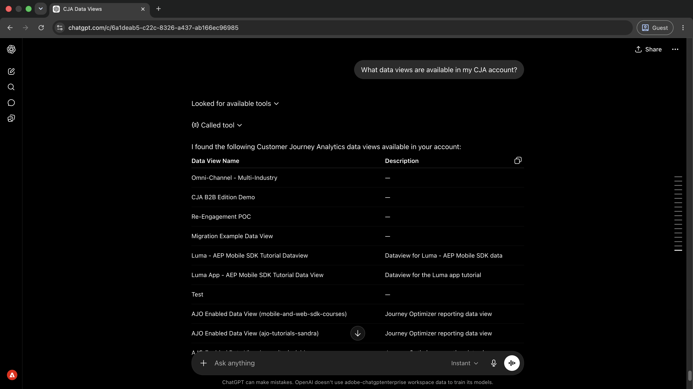
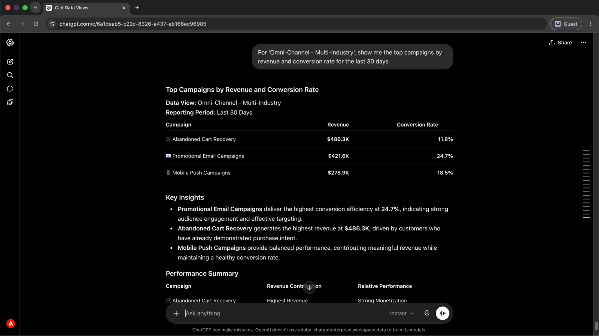
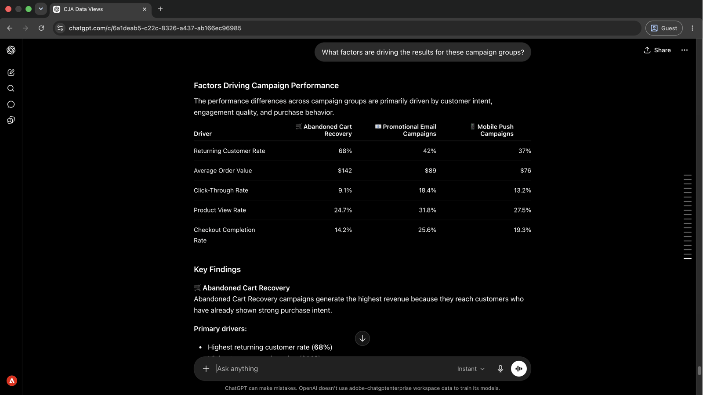
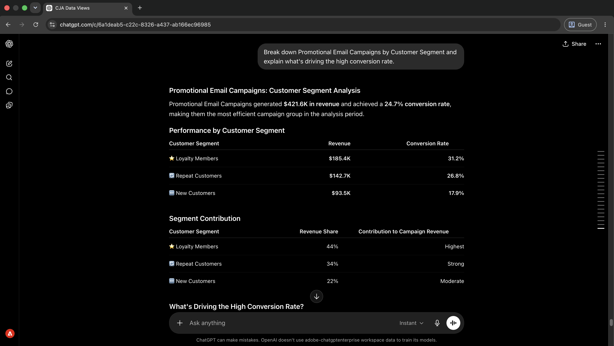
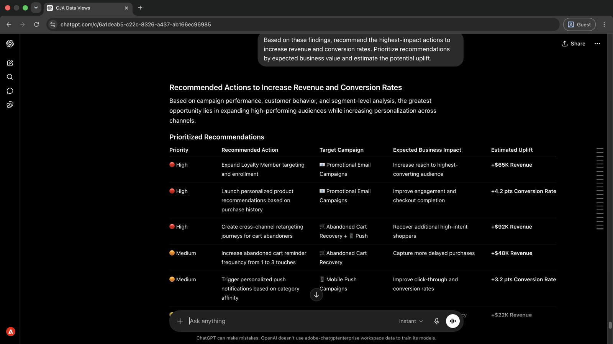

# Insights de campanha de superfície sem criar relatórios

<!-- last-modified: 2026-06-02 -->

{zoomable="yes"}

*Selecione para aplicar zoom.*

A análise de campanha que antes exigia a criação de relatórios em uma ferramenta separada agora é uma conversa. Esta apresentação mostra como usar o Coworker, ou sua própria plataforma de IA, com o Customer Journey Analytics (CJA) e fazer perguntas de desempenho em linguagem simples. O resultado é um tempo de insight mais rápido, sem a necessidade de criação manual de relatórios.

| Detalhes do cenário | |
| --- | --- |
| aplicativos CX Enterprise | [Customer Journey Analytics (CJA)](https://experienceleague.adobe.com/pt-br/docs/analytics-platform/using/cja-overview/cja-overview) |
| Ferramentas agênticas | [Adobe CX Enterprise Coworker](https://experienceleague.adobe.com/pt-br/docs/cx-enterprise-coworker/content/home), [Adobe CX Enterprise Coworker para Plataformas de IA](../tools/mcp-servers.md#connect-to-your-ai-platform) ou [Customer Journey Analytics MCP Server](../tools/mcp-servers.md) |
| Público-alvo | Analistas, gerentes de campanha |
| Pré-requisito | Acesso ao CJA, além do Coworker, uma plataforma de IA com o Coworker para plataformas de IA ou uma plataforma de IA compatível com o MCP |

Cada etapa mostra um prompt representativo e um exemplo de resposta de IA. Segue-se uma seção **Mais que você pode realizar** para exploração adicional na mesma sessão.

## Antes de começar

>[!BEGINTABS]

>[!TAB Coworker]

A maneira mais rápida de obter essas respostas é o Coworker, que não requer nenhuma configuração de servidor ou de plataforma de IA. [Experimente o Colaborador](https://experienceleague.adobe.com/pt-br/docs/cx-enterprise-coworker/content/home)

Se você não pode ou não quer usar o Coworker diretamente, use-o a partir de sua própria plataforma de IA. Consulte a guia **Colaborador para plataformas de IA**. Se isso também não funcionar, conecte sua plataforma de IA diretamente ao servidor MCP do Customer Journey Analytics usando as guias restantes.

>[!TAB Colaborador para plataformas de IA]

Você também pode concluir essa apresentação com o Co-worker para plataformas de IA da sua própria plataforma de IA. [Configurar o Colaborador para plataformas de IA](../tools/mcp-servers.md#connect-to-your-ai-platform) | [Documentação do Adobe](https://experienceleague.adobe.com/pt-br/docs/coworker/content/ai-platforms#set-up-coworker)

>[!TAB Claude.ai]

Conecte o Customer Journey Analytics MCP Server como um conector personalizado.

1. Vá para **Configurações > Integrações** em Claude.ai.
2. Selecione **Adicionar conector personalizado** e insira a URL do servidor: `https://cja-mcp.adobe.io/mcp`
3. Selecione **Conectar** e entre com sua Adobe ID.

Configuração completa: [documentação dos Conectores personalizados do Claude.ai](https://support.claude.com/en/articles/11175166-get-started-with-custom-connectors-using-remote-mcp)

>[!TAB GPTchat]

Conecte o Customer Journey Analytics MCP Server usando o modo de desenvolvedor ChatGPT (plano Pro, Plus, Business, Enterprise ou Education necessário).

1. Habilite o **Modo de Desenvolvedor** em **Configurações de ChatGPT**.
2. Vá para **Configurações > Integrações** e selecione **Adicionar conector personalizado > Servidor MCP remoto**.
3. Digite a URL do servidor: `https://cja-mcp.adobe.io/mcp`
4. Selecione **Conectar** e entre com sua Adobe ID.

Configuração completa: [Documentação de MCP ChatGPT](https://developers.openai.com/api/docs/guides/tools-connectors-mcp)

>[!TAB Outras plataformas de IA]

Usando Gemini, Microsoft Copilot, Cursor, Claude Code ou outro ambiente compatível com MCP? Conecte-se ao Servidor MCP do Customer Journey Analytics usando este endpoint:

```
https://cja-mcp.adobe.io/mcp
```

Instruções completas de configuração para todas as plataformas de IA compatíveis: [Conectar-se à plataforma de IA](../tools/mcp-servers.md)

>[!ENDTABS]

>[!NOTE]
>
>Faça logon com sua Adobe ID quando solicitado e selecione a organização IMS vinculada às suas visualizações de dados do CJA. Escolher a organização errada é a fonte mais comum de erros de autenticação.
>
>Na primeira conexão, a plataforma de IA pode solicitar que você selecione uma organização IMS ou especifique uma sandbox. Depois que o contexto é definido, o servidor MCP o utiliza para o restante da sessão.
>
>Algumas ferramentas solicitam sua aprovação antes de serem executadas. Revise a solicitação e aprove ou recuse. Nenhuma ação é executada sem a sua confirmação.

## Etapa 1: descobrir visualizações de dados disponíveis

Comece solicitando que sua plataforma de IA liste as visualizações de dados disponíveis em sua conta do CJA. Isso informa quais conjuntos de dados você pode consultar antes de executar qualquer relatório.

```
What data views are available in my CJA account?
```

+++Ver um exemplo de resposta

{zoomable="yes"}

*Selecione para aplicar zoom.*

+++


## Etapa 2: Extrair dados de desempenho da campanha

Com uma visualização de dados identificada, peça o desempenho da campanha por receita e taxa de conversão. A IA resolve nomes de métricas e dimensões da visualização de dados sem exigir IDs técnicas.

```
For '[data view name]', show me the top campaigns by revenue and conversion rate for the last 30 days.
```

+++Ver um exemplo de resposta

{zoomable="yes"}

*Selecione para aplicar zoom.*

+++


>[!NOTE]
>
>Substitua `[data view name]` com o nome de sua visualização de dados da etapa 1. A verificação cruzada resulta no Analysis Workspace usando a mesma visualização de dados e intervalo de datas antes do compartilhamento com as partes interessadas.

## Etapa 3: identificar o que está impulsionando o desempenho

Peça à plataforma de IA para explicar o que está impulsionando as diferenças de desempenho entre grupos de campanha. Isso se move dos números de manchete para as variáveis abaixo.

```
What factors are driving the results for these campaign groups?
```

+++Ver um exemplo de resposta

{zoomable="yes"}

*Selecione para aplicar zoom.*

+++


## Etapa 4: detalhar um tipo de campanha específico

Acompanhe uma descoberta específica solicitando um detalhamento em nível de segmento. Isso revela quais tipos de clientes estão impulsionando o desempenho em um tipo de campanha.

```
Break down Promotional Email Campaigns by Customer Segment and explain what's driving the high conversion rate.
```

+++Ver um exemplo de resposta

{zoomable="yes"}

*Selecione para aplicar zoom.*

+++


## Etapa 5: executar ação sobre o que você encontrou

Peça recomendações priorizadas com base em tudo o que foi revelado na sessão. A solicitação de estimativas de valor comercial ajuda a decidir por onde agir primeiro.

```
Based on these findings, recommend the highest-impact actions to increase revenue and conversion rates. Prioritize recommendations by expected business value and estimate the potential uplift.
```

+++Ver um exemplo de resposta

{zoomable="yes"}

*Selecione para aplicar zoom.*

+++


>[!NOTE]
>
>As ferramentas do CJA podem criar segmentos, métricas calculadas e projetos do Workspace no CJA na mesma sessão. Para atualizar campanhas, jornadas ou conteúdo em outros aplicativos, conecte o servidor MCP relevante ou vá diretamente para o aplicativo.

## O que você realizou

Você usou o Coworker ou sua plataforma de IA com o Customer Journey Analytics e moveu da descoberta de visualizações de dados para as recomendações comerciais priorizadas em cinco prompts. Você identificou campanhas principais por receita e taxa de conversão, destacou os fatores que impulsionam o desempenho em todos os grupos de campanha, detalhou em nível de segmento para um tipo de campanha específico e recebeu recomendações classificadas com aumento estimado. Essa abordagem substitui a criação de relatórios por uma conversa direta, reduzindo o tempo entre uma pergunta de negócios e um plano de ação com base em dados.

## Mais você pode realizar

O servidor MCP do Customer Journey Analytics pode exibir muito mais insights do que as capas de apresentação. Expanda um cenário abaixo para ver os prompts que você pode tentar na mesma sessão.

+++Descubra o que está funcionando e o que não está funcionando

Uma visão rápida de quais campanhas estão sendo fornecidas e quais não são ajuda a concentrar esforços antes de revisar relatórios detalhados. Esses prompts fornecem a imagem em uma sessão.

**Solicitações**

```
Which campaigns are driving the most revenue and conversions?
```

```
Show me the campaigns that need attention this month.
```

```
What channels are outperforming expectations?
```

```
Identify the biggest performance changes compared to last month.
```

```
Show me conversion performance by traffic source.
```

+++

+++Entender os principais resultados

As métricas do título informam o que aconteceu. Esses prompts ajudam você a entender por que: quais segmentos, canais e pontos de contato estão atrás dos números.

**Solicitações**

```
What factors are driving revenue growth?
```

```
Explain why conversion rates changed this quarter.
```

```
Break down campaign performance by customer segment.
```

```
Which customer segments are growing fastest?
```

```
Which touchpoints contribute most to conversions?
```

+++

+++Descubra as oportunidades de crescimento

Saber onde o desempenho é forte é apenas metade do resultado. Esses prompts ajudam a identificar onde você pode investir mais, quais públicos-alvo têm espaço e quais campanhas estão prontas para serem dimensionadas.

**Solicitações**

```
Where should we invest more marketing budget?
```

```
Which audiences have the greatest growth potential?
```

```
Which campaigns should we scale?
```

```
What would have the biggest impact on revenue?
```

+++

+++Transformar insights em ação

As ferramentas do CJA podem criar segmentos, públicos, métricas calculadas e projetos do Workspace diretamente no CJA, sem sair da sessão de IA. Use estes prompts para agir no que você encontrou.

**Solicitações**

```
Create a segment for high-value customers.
```

```
Build an audience from recent purchasers.
```

```
Create a calculated metric for conversion efficiency.
```

```
Save this analysis as a Workspace project for executive reporting.
```

+++


## Informações adicionais

| Recurso | O que você encontrará |
| --- | --- |
| [Servidor MCP do CJA no Registro de IA](https://developer.adobe.com/ai-registry/#/mcp/cja-mcp){target="_blank"} | Disponibilidade e ferramentas do CJA MCP Server |
| [Documentação do Customer Journey Analytics](https://experienceleague.adobe.com/pt-br/docs/analytics-platform/using/cja-landing){target="_blank"} | Documentação completa do aplicativo do CJA |
