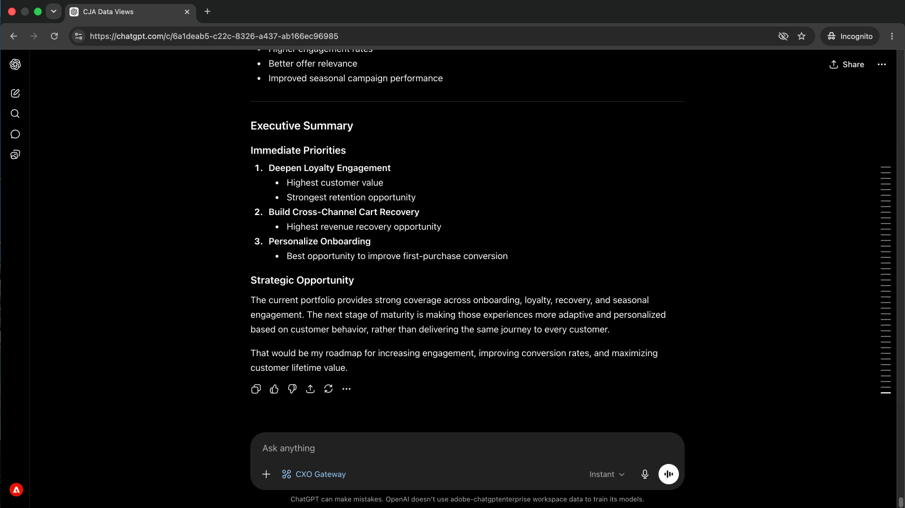
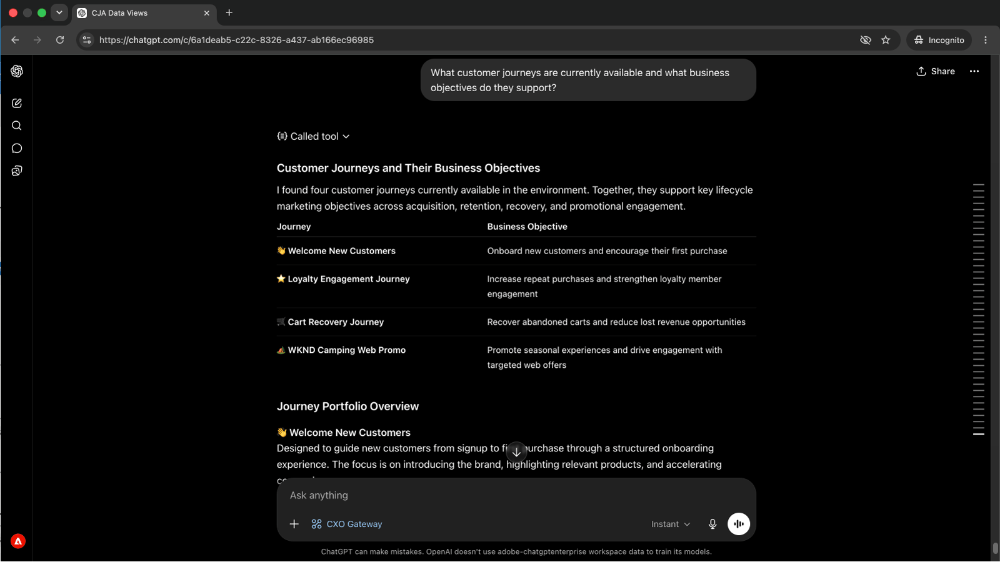
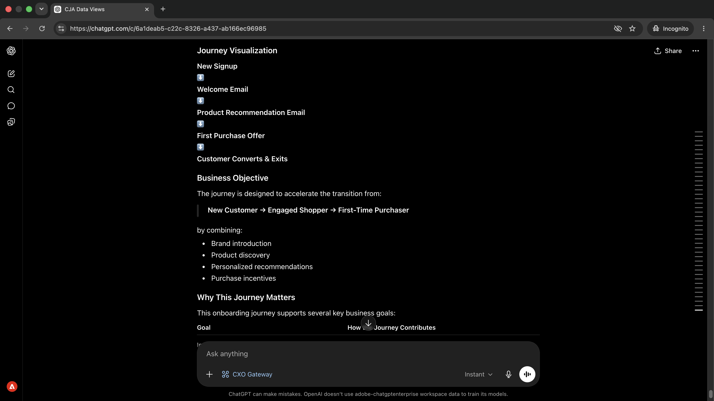
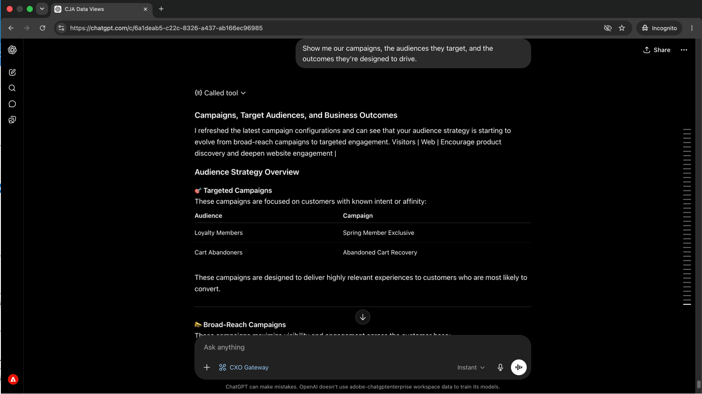
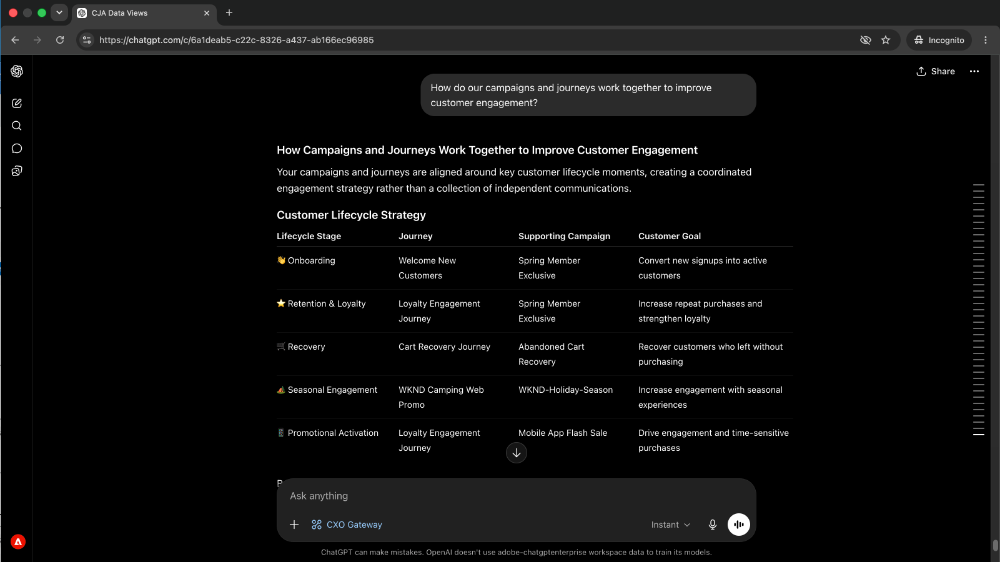
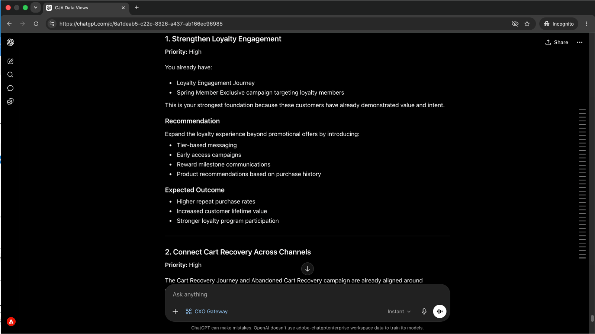

# Identifique problemas de jornada antes que afetem os clientes
<!-- last-modified: 2026-06-08 -->

{zoomable="yes"}

*Selecione para aplicar zoom.*

Jornada problemas que não são detectados e que podem chegar aos clientes antes que qualquer pessoa perceba. Esta apresentação mostra como ficar à frente deles verificando jornadas ativas do AJO, revisando a configuração da campanha e abordando problemas operacionais por meio de uma plataforma de IA, usando o servidor MCP do Adobe Journey Optimizer para obter respostas em linguagem simples sem abrir o Adobe Journey Optimizer.

| Detalhes do cenário | |
| --- | --- |
| aplicativos CX Enterprise | [Adobe Journey Optimizer (AJO)](https://experienceleague.adobe.com/pt-br/docs/journey-optimizer/using/ajo-home) |
| Ferramentas agênticas | [Adobe CX Enterprise Coworker](https://experienceleague.adobe.com/pt-br/docs/cx-enterprise-coworker/content/home), [Adobe CX Enterprise Coworker para Plataformas de IA](../tools/mcp-servers.md#connect-to-your-ai-platform) ou [Adobe Journey Optimizer MCP Server](../tools/mcp-servers.md) |
| Público-alvo | Gerentes de campanha, profissionais de marketing |
| Pré-requisito | Acesso ao AJO, além do Coworker, uma plataforma de IA com o Coworker para plataformas de IA ou uma plataforma de IA compatível com o MCP |

Cada etapa mostra um prompt representativo e um exemplo de resposta de IA. Segue-se uma seção **Mais que você pode realizar** para exploração adicional na mesma sessão.


## Antes de começar

>[!BEGINTABS]

>[!TAB Coworker]

A maneira mais rápida de obter essas respostas é o Coworker, que não requer nenhuma configuração de servidor ou de plataforma de IA. [Experimente o Colaborador](https://experienceleague.adobe.com/pt-br/docs/cx-enterprise-coworker/content/home)

Se você não pode ou não quer usar o Coworker diretamente, use-o a partir de sua própria plataforma de IA. Consulte a guia **Colaborador para plataformas de IA**. Se isso também não funcionar, conecte sua plataforma de IA diretamente ao servidor MCP do Adobe Journey Optimizer usando as guias restantes.

>[!TAB Colaborador para plataformas de IA]

Você também pode concluir essa apresentação com o Co-worker para plataformas de IA da sua própria plataforma de IA. [Configurar o Colaborador para plataformas de IA](../tools/mcp-servers.md#connect-to-your-ai-platform) | [Documentação do Adobe](https://experienceleague.adobe.com/pt-br/docs/coworker/content/ai-platforms#set-up-coworker)

>[!TAB Claude.ai]

Conecte o Adobe Journey Optimizer MCP Server como um conector personalizado.

1. Vá para **Configurações > Integrações** em Claude.ai.
2. Selecione **Adicionar conector personalizado** e insira a URL do servidor: `https://ajo-mcp.adobe.io/mcp`
3. Selecione **Conectar** e entre com sua Adobe ID.

Configuração completa: [documentação dos Conectores personalizados do Claude.ai](https://support.claude.com/en/articles/11175166-get-started-with-custom-connectors-using-remote-mcp)

>[!TAB GPTchat]

Conecte o Adobe Journey Optimizer MCP Server usando o modo de desenvolvedor ChatGPT (plano Pro, Plus, Business, Enterprise ou Education necessário).

1. Habilite o **Modo de Desenvolvedor** em **Configurações de ChatGPT**.
2. Vá para **Configurações > Integrações** e selecione **Adicionar conector personalizado > Servidor MCP remoto**.
3. Digite a URL do servidor: `https://ajo-mcp.adobe.io/mcp`
4. Selecione **Conectar** e entre com sua Adobe ID.

Configuração completa: [Documentação de MCP ChatGPT](https://developers.openai.com/api/docs/guides/tools-connectors-mcp)

>[!TAB Outras plataformas de IA]

Usando Gemini, Microsoft Copilot, Cursor, Claude Code ou outro ambiente compatível com MCP? Conecte-se ao Servidor MCP do Adobe Journey Optimizer usando este endpoint:

```
https://ajo-mcp.adobe.io/mcp
```

Instruções completas de configuração para todas as plataformas de IA compatíveis: [Conectar-se à plataforma de IA](../tools/mcp-servers.md)

>[!ENDTABS]

>[!NOTE]
>
>Faça logon com sua Adobe ID quando solicitado e selecione a organização IMS vinculada ao seu ambiente AJO. Escolher a organização errada é a fonte mais comum de erros de autenticação.
>
>Na primeira conexão, a plataforma de IA pode solicitar que você selecione uma organização IMS ou especifique uma sandbox. Depois que o contexto é definido, o servidor MCP o utiliza para o restante da sessão.
>
>Algumas ferramentas solicitam sua aprovação antes de serem executadas. Revise a solicitação e aprove ou recuse. Nenhuma ação é executada sem a sua confirmação.


## Etapa 1: Descubra jornadas ativas e sua finalidade

Comece solicitando um inventário das jornadas ativas e os objetivos de negócios por trás delas. Isso dá a você o quadro completo antes de mergulhar em qualquer jornada específica.

```
What customer journeys are currently available and what business objectives do they support?
```

+++Ver um exemplo de resposta

{zoomable="yes"}

*Selecione para aplicar zoom.*

+++


## Etapa 2: analisar as etapas de uma jornada e a experiência do cliente

Com a lista de jornadas na exibição, peça à sua plataforma de IA para percorrer as etapas de uma jornada específica e explicar o que o cliente experimenta em cada estágio.

```
Walk me through the [journey name] journey and explain the customer experience.
```

+++Ver um exemplo de resposta

{zoomable="yes"}

*Selecione para aplicar zoom.*

+++


>[!NOTE]
>
>Substitua `[journey name]` com o nome de uma jornada dos resultados da etapa 1.


## Etapa 3: revisar campanhas, públicos e objetivos

Mudança de jornadas para campanhas. Solicite um resumo de quais campanhas estão ativas, quem elas direcionam e quais resultados elas foram projetadas para impulsionar.

```
Show me our campaigns, the audiences they target, and the outcomes they're designed to drive.
```

+++Ver um exemplo de resposta

{zoomable="yes"}

*Selecione para aplicar zoom.*

+++


## Etapa 4: entender como as campanhas e o jornada se conectam

Peça à plataforma de IA para conectar os pontos entre campanhas e jornadas e explicar como elas trabalham juntas em prol de metas de engajamento compartilhado.

```
How do our campaigns and journeys work together to improve customer engagement?
```

+++Ver um exemplo de resposta

{zoomable="yes"}

*Selecione para aplicar zoom.*

+++


## Etapa 5: Obtenha recomendações priorizadas

Peça recomendações priorizadas sobre no que focar a seguir, enquadradas pela perspectiva de um gerenciador de marketing do ciclo de vida. Isso revela as lacunas e oportunidades mais impactantes de tudo o que foi revisado na sessão.

```
If you were our lifecycle marketing manager, what would you prioritize next and why?
```

+++Ver um exemplo de resposta

{zoomable="yes"}

*Selecione para aplicar zoom.*

+++


>[!NOTE]
>
>O AJO MCP Server exibe informações de jornada e campanha, mas não pode modificar jornadas, campanhas ou conteúdo. Para implementar as recomendações, acesse o aplicativo do AJO diretamente ou conecte o AEM Content MCP Server para alterações de conteúdo na mesma sessão.


## O que você realizou

Você usou o Coworker ou a plataforma de IA com o Adobe Journey Optimizer e criou uma imagem completa do portfólio do jornada e da campanha por meio de cinco prompts. Você inventariou jornadas ativas e seus objetivos de negócios, revisou a experiência passo a passo do cliente para uma jornada específica, mapeou campanhas ativas para seus públicos e resultados pretendidos, entendeu como campanhas e jornadas funcionam juntas e recebeu recomendações priorizadas sobre onde se concentrar em seguida. Isso proporciona visibilidade estratégica ao marketing de ciclo de vida e aos gerentes de campanha sem precisar abrir a interface do AJO.


## Mais você pode realizar

O Adobe Journey Optimizer MCP Server pode exibir uma grande variedade de detalhes de jornadas e campanhas do AJO. Expanda um cenário abaixo para ver os prompts que você pode tentar na mesma sessão.

+++Saiba o que há de novo antes de fazer uma mudança

Fazer alterações em uma jornada sem saber o que mais está sendo executado é arriscado. Esses prompts fornecem um inventário atual do que está ativo, o que foi modificado recentemente e como as campanhas são configuradas.

**Solicitações**

```
Show me all journeys modified in the last 7 days.
```

```
Show me all journeys that use SMS as a channel.
```

```
Which campaigns are scheduled to end this week?
```

```
What loyalty challenges are currently active?
```

+++

+++Acessar os detalhes de uma jornada específica

Quando você precisa revisar, aprovar ou entregar uma jornada, ter a lógica completa à sua frente sem abrir o AJO economiza tempo. Isso avisa as condições de superfície, as programações e as regras de segmento sob demanda.

**Solicitações**

```
What is the entry condition for the [journey name] journey?
```

```
What are the exit conditions and timeout rules for the [journey name] journey?
```

```
What messages and wait conditions are in the [journey name] journey?
```

```
Which segment does the [journey name] journey target?
```

+++

+++Acessar os detalhes de uma campanha específica

Quando é necessário revisar a configuração completa de uma campanha antes de aprovar, entregar ou fazer alterações, esses prompts exibem regras de público-alvo, configurações de canal e detalhes de agendamento sem abrir o AJO.

**Solicitações**

```
Walk me through the full configuration of the [campaign name] campaign.
```

```
What audience does the [campaign name] campaign target and how large is that segment?
```

```
What frequency cap and send schedule apply to the [campaign name] campaign?
```

```
Are any campaigns targeting overlapping audiences?
```

```
What channel configurations are set up in our AJO environment?
```

+++


## Informações adicionais

| Recurso | O que você encontrará |
| --- | --- |
| [Servidor MCP do AJO no Registro de IA](https://developer.adobe.com/ai-registry/#/mcp/ajo-mcp-server){target="_blank"} | Disponibilidade e ferramentas do AJO MCP Server |
| [Documentação do AJO](https://experienceleague.adobe.com/pt-br/docs/journey-optimizer/using/ajo-home){target="_blank"} | Documentação completa do aplicativo do AJO |
